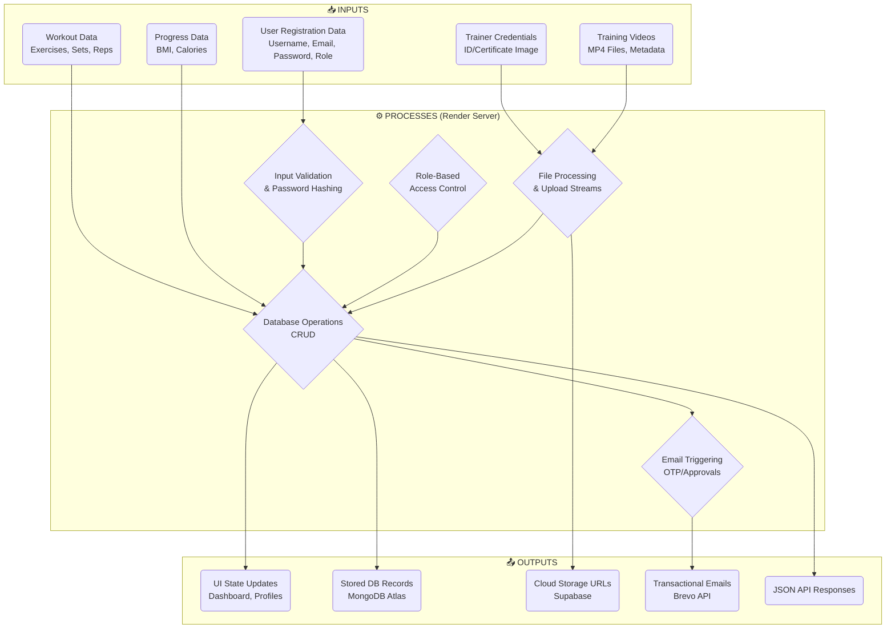
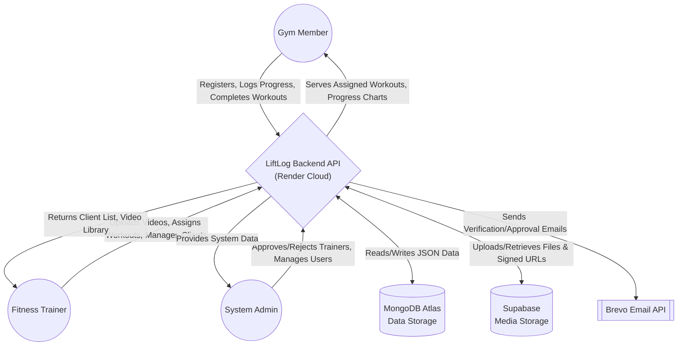
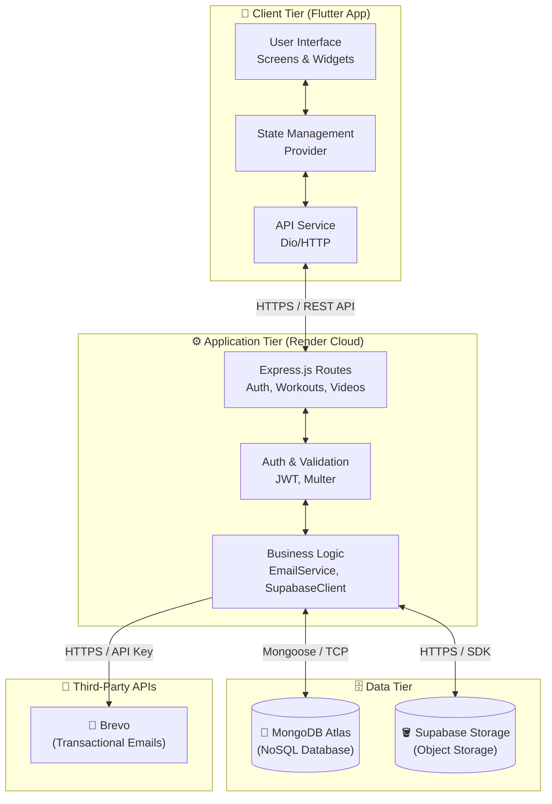

# LiftLog System Workflow & Architecture

This document contains the system architecture and workflow diagrams for the LiftLog application. These diagrams are written using Mermaid.js syntax and can be previewed directly in Markdown viewers that support Mermaid (like GitHub, VS Code, or Notion).

## 1. Input Process Output (IPO) Diagram



---

## 2. Context Diagram



---

## 3. Entity Relationship Diagram (ERD)

```mermaid
graph TD
    %% Models
    User["User Model"]
    Workout["Workout Model"]
    Video["ExerciseVideo Model"]
    Progress["Progress Model"]

    %% Relationships
    User -->|Has Many| Workout
    User -->|Uploads| Video
    User -->|Logs| Progress
    User -->|Assigns / Has| User

    %% User Fields
    subgraph User Fields
        U1(_id: ObjectId PK)
        U2(username: String)
        U3(email: String)
        U4(password: String Hashed)
        U5(role: member, trainer, admin)
        U6(isApproved: Boolean)
        U7(isEmailVerified: Boolean)
        U8(credentialImageUrl: String)
        U9(trainer: ObjectId FK)
    end
    User --- U1 & U2 & U3 & U4 & U5 & U6 & U7 & U8 & U9

    %% Workout Fields
    subgraph Workout Fields
        W1(_id: ObjectId PK)
        W2(title: String)
        W3(description: String)
        W4(isTemplate: Boolean)
        W5(isPublic: Boolean)
        W6(user: ObjectId FK)
        W7(trainer: ObjectId FK)
        W8(assignedTo: ObjectId FK)
        W9(completedAt: Date)
    end
    Workout --- W1 & W2 & W3 & W4 & W5 & W6 & W7 & W8 & W9

    %% Video Fields
    subgraph Video Fields
        V1(_id: ObjectId PK)
        V2(title: String)
        V3(trainer: ObjectId FK)
        V4(videoUrl: String URL)
        V5(thumbnailUrl: String URL)
        V6(exerciseType: String)
        V7(difficulty: String)
        V8(duration: Number)
    end
    Video --- V1 & V2 & V3 & V4 & V5 & V6 & V7 & V8

    %% Progress Fields
    subgraph Progress Fields
        P1(_id: ObjectId PK)
        P2(user: ObjectId FK)
        P3(bmi: Number)
        P4(caloriesIntake: Number)
        P5(calorieDeficit: Number)
        P6(date: Date)
    end
    Progress --- P1 & P2 & P3 & P4 & P5 & P6
```



---

## 4. System Architecture



---

## 5. Database Integration Workflow (MongoDB & Supabase)

This sequence diagram illustrates how the backend orchestrates data between MongoDB (structured data) and Supabase (binary file storage) during a media upload process (e.g., uploading a training video or trainer credentials).

```mermaid
graph TD
    %% Entities
    Client[📱 Mobile App]
    API[⚙️ Backend Server]
    Supa[(🪣 Supabase Storage)]
    Mongo[(🍃 MongoDB Atlas)]

    %% Step 1: Request
    Client -->|1. POST /api/videos\n(File + Metadata)| API

    %% Step 2: Auth & Parse
    API -->|2. Verify Token & Parse File| API

    %% Step 3: Video Upload
    API -->|3. Upload .mp4 File| Supa
    Supa -->|4. Return Signed URL & Path| API

    %% Step 4: Thumbnail Generation
    API -->|5. Generate Thumbnail Image| API

    %% Step 5: Thumbnail Upload
    API -->|6. Upload .jpg File| Supa
    Supa -->|7. Return Thumbnail Path| API

    %% Step 6: Database Save
    API -->|8. Save Document\n(Titles, Tags, Supabase URLs)| Mongo
    Mongo -->|9. Success Confirmation| API

    %% Step 7: Response
    API -->|10. Return 201 Created JSON| Client
```

---

## 6. Backend Server Request Lifecycle

This flowchart breaks down the internal architecture and request processing pipeline inside the Express.js Node Server hosted on Render.

```mermaid
graph TD
    Client([Incoming Client Request]) --> API_Gateway[Express Entry Point\n(server.js)]
    
    subgraph Express Pipeline ["⚙️ Express.js Request Lifecycle"]
        API_Gateway --> CORS[CORS & Body Parser Middleware]
        CORS --> Auth{Auth Middleware\n(verifyToken)}
        
        Auth -->|Invalid/No Token| Reject[401/403 Error Response]
        Auth -->|Valid Token| Routes[Route Handlers]
        
        Routes -->|/api/auth| AuthLogic[Auth Routes\n(Login, Register, Admin)]
        Routes -->|/api/workouts| WorkoutLogic[Workout Routes\n(CRUD, Assign)]
        Routes -->|/api/videos| VideoLogic[Video Routes\n(Upload, Stream, Delete)]
        Routes -->|/api/progress| ProgressLogic[Progress Routes\n(BMI, Calories, Charts)]
        
        AuthLogic --> Controller[Controllers / Mongoose Models]
        WorkoutLogic --> Controller
        VideoLogic --> Controller
        ProgressLogic --> Controller
        
        Controller --> Format[Format JSON Response]
    end

    Controller <--> DB[(MongoDB Atlas)]
    Controller <--> Storage[(Supabase Buckets)]
    Controller --> Emailer[[Brevo Email API]]
    
    Format --> Return([Send Response to Client])
```
