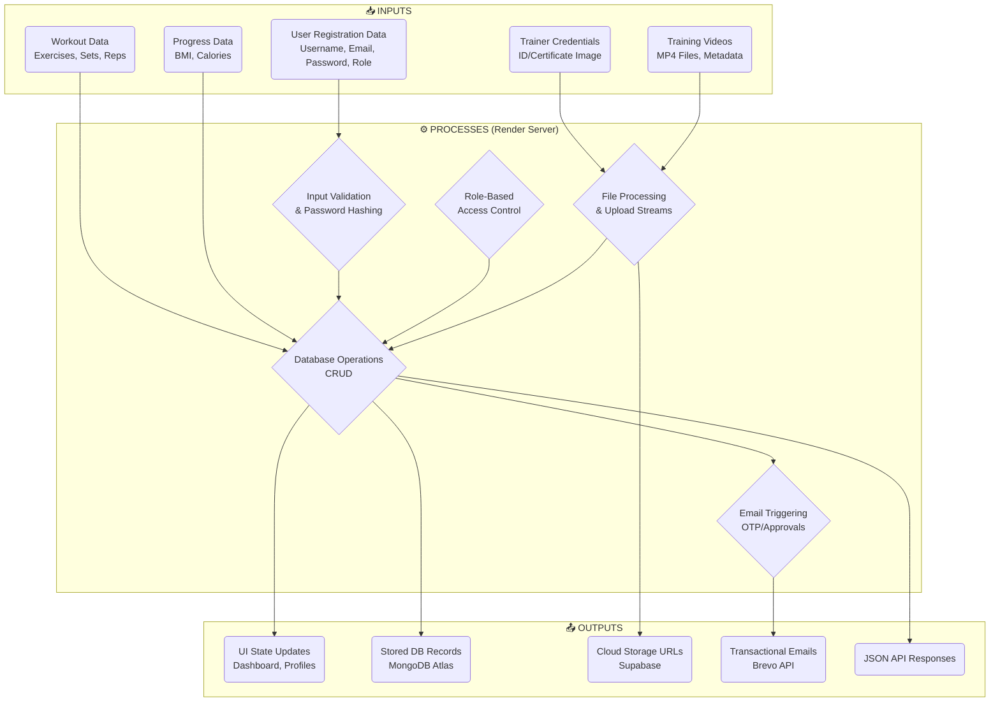
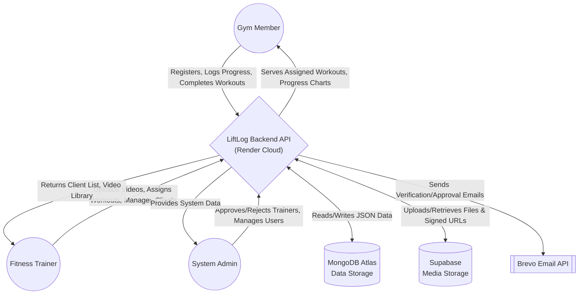
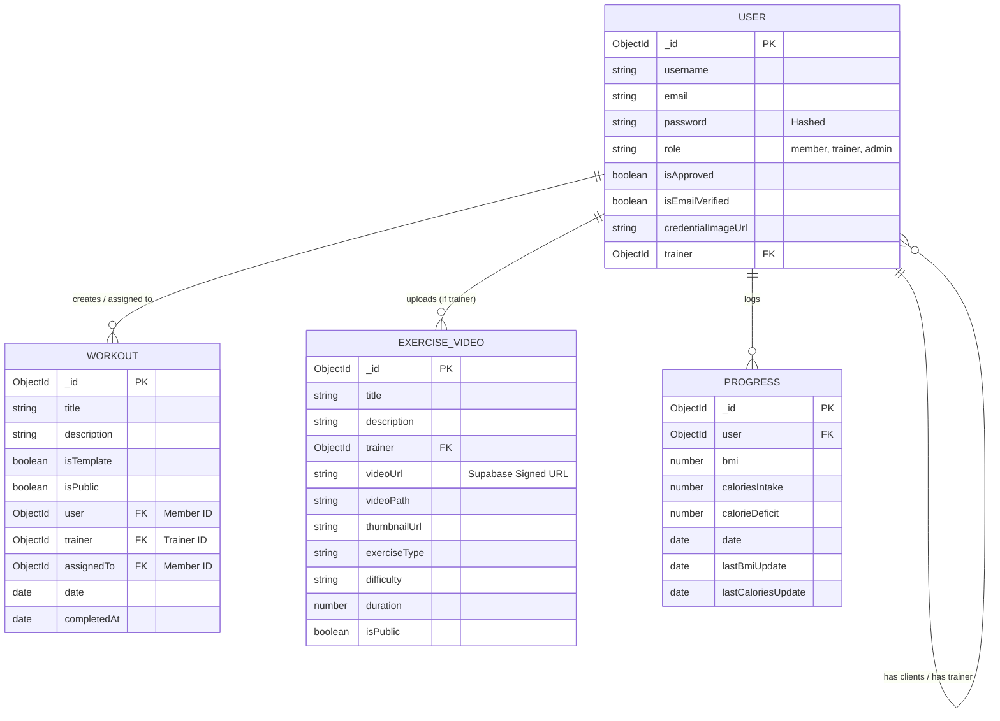
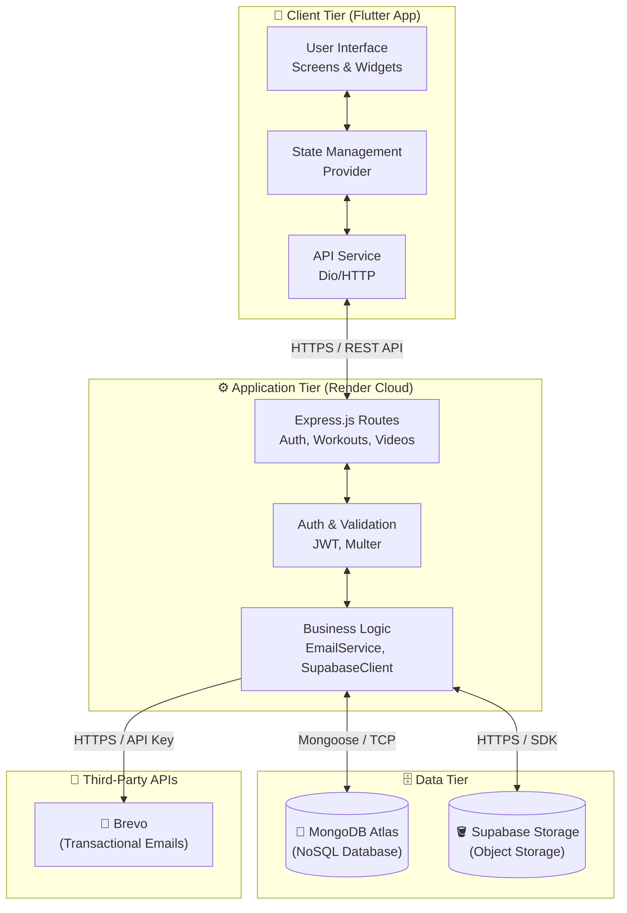

# LiftLog System Workflow & Architecture

This document contains the system architecture and workflow diagrams for the LiftLog application. These diagrams are written using Mermaid.js syntax and can be previewed directly in Markdown viewers that support Mermaid (like GitHub, VS Code, or Notion).

## 1. Input Process Output (IPO) Diagram

---

## 2. Context Diagram

---

## 3. Entity Relationship Diagram (ERD)

---

## 4. System Architecture

